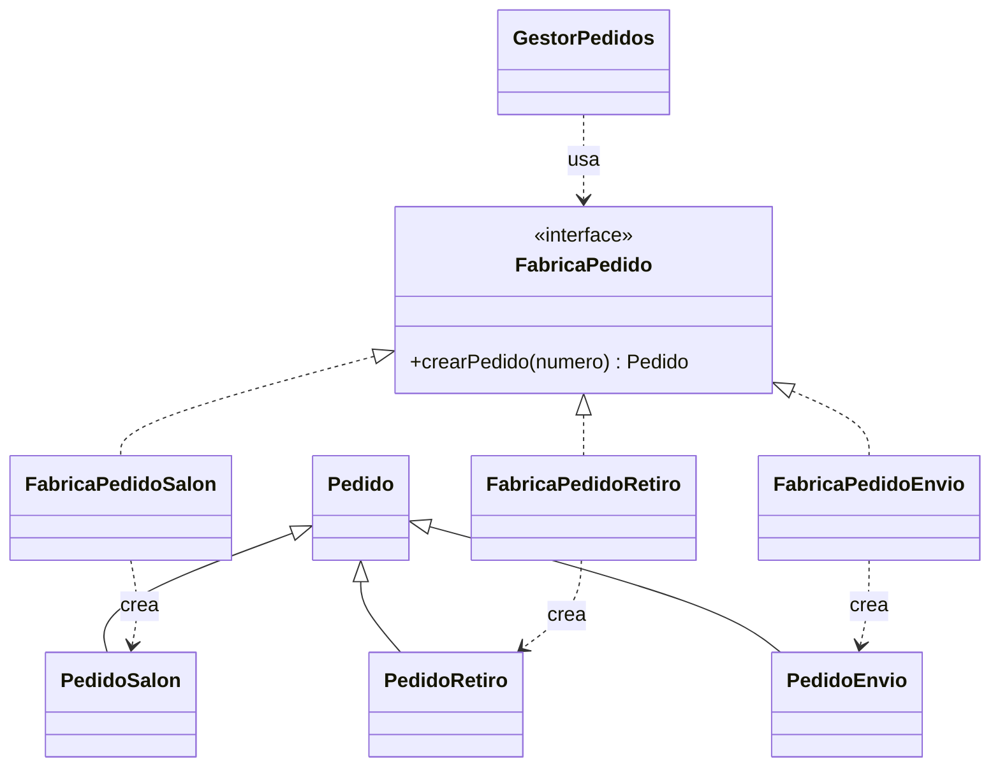
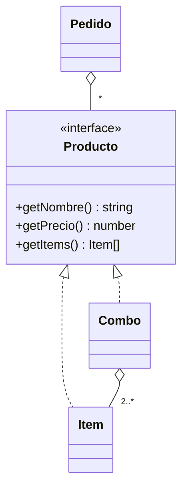
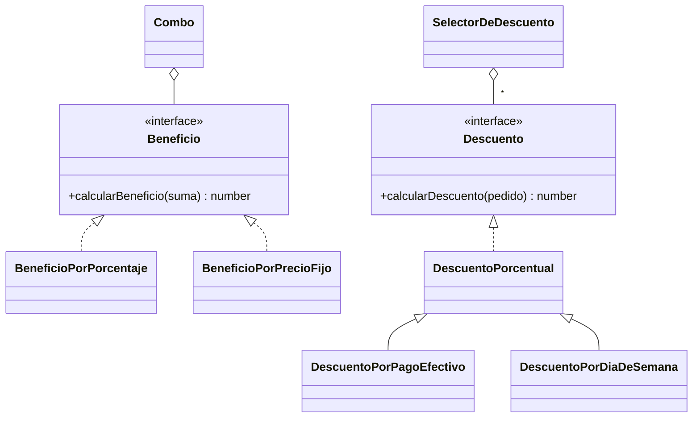
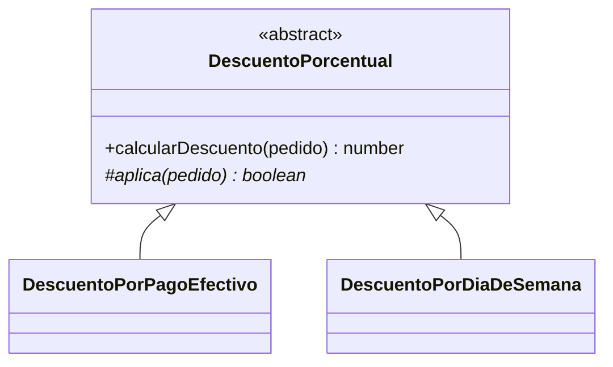
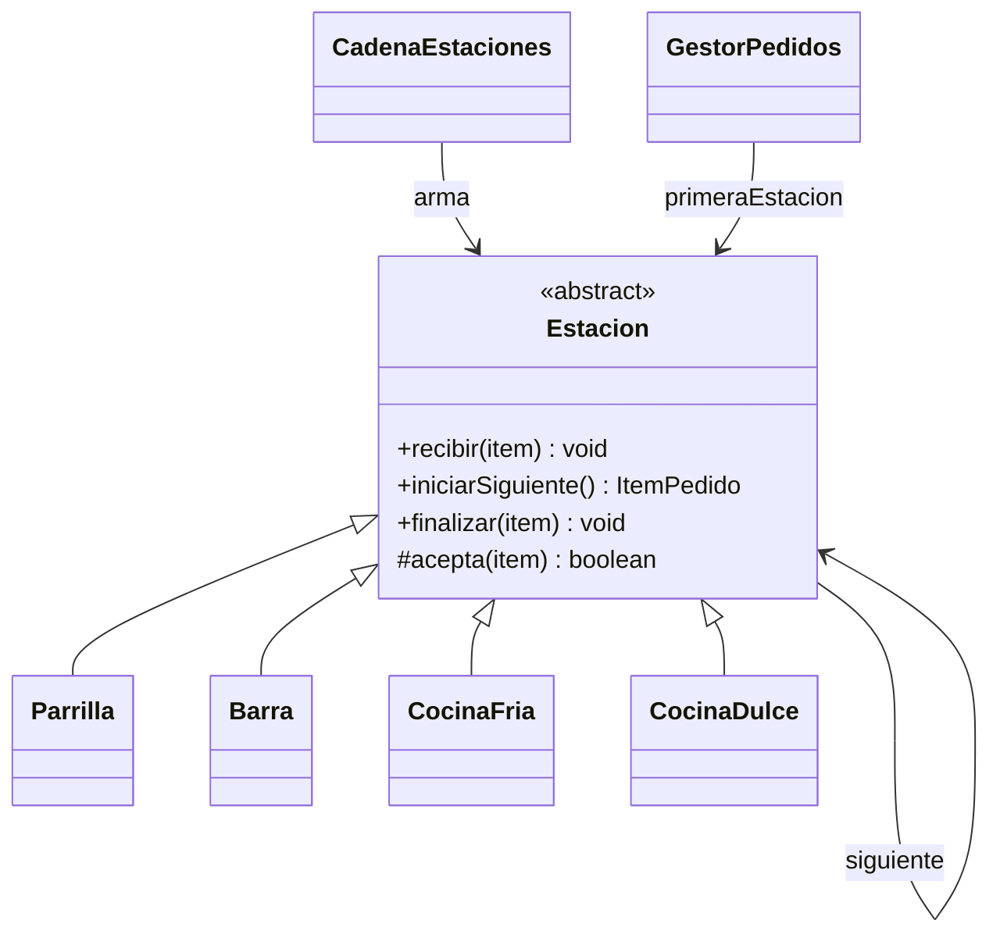

# Fogón del Barrio - Gestión de Pedidos

Trabajo práctico de Programación II, Grupo 5.

Sistema en TypeScript para el restaurante "Fogón del Barrio". El sistema:

- toma pedidos en salón, para retirar y con envío;
- reparte los ítems entre las estaciones de la cocina;
- arma la cuenta aplicando el mejor descuento disponible;
- guarda el historial de lo cobrado.

## Integrantes

| Nombre | Usuario de GitHub |
|---|---|
| Bruno Enrigo | BrunoE99 |
| Juan Francisco Damelio | juanfdamelio |

## Instalación y ejecución

Hace falta Node.js (versión LTS). Desde la carpeta del proyecto:

```bash
npm install          # instala las dependencias
npm run dev-mode     # ejecuta la demo (src/index.ts) sin compilar
npm run build        # corre ESLint y compila a dist/
npm start            # ejecuta la versión compilada
npm test             # compila y corre las pruebas
npx jest --coverage  # corre las pruebas con reporte de cobertura (coverage/)
npx typedoc          # genera la documentación JSDoc en docs/
```

La demo registra tres pedidos, uno de cada modalidad:

1. Los confirma.
2. Hace que cada estación prepare sus ítems.
3. Los factura.
4. Muestra el historial con la factura de cada uno.

Las pruebas usan Jest y están en `tests/`. La cobertura supera el 80 %.

## Estructura

```text
diagramas/   diagrama de clases y diagramas de secuencia (PlantUML)
src/
  beneficio/         beneficios de combos y descuentos del pedido
  estacion/          estaciones de cocina y la cadena que las une
  excepciones/       errores propios del sistema
  medios_de_pago/    efectivo, tarjetas y billetera virtual
  menu/              menú, ítems y combos
  pedido/            pedidos, gestor, factura y fábricas de pedidos
  index.ts           demo
tests/       pruebas unitarias
```

## Funcionamiento

`GestorPedidos` es la clase desde la que se usa el sistema.

**Estados del pedido.** Un pedido pasa por estos estados:

```text
EN_CONSTRUCCION  →  CONFIRMADO  →  FACTURADO
```

- **En construcción:** se pueden agregar y quitar productos, y deshacer la última modificación.
- **Al confirmarlo:** cada producto se separa en sus ítems, y los de un combo también. Desde ese momento ya no admite cambios.
- **Para facturarlo:** todos los ítems tienen que estar listos y tiene que tener un medio de pago.

**Preparación en la cocina.** Cada ítem recorre la cadena de estaciones hasta llegar a la que prepara su categoría:

| Estación | Prepara |
|---|---|
| Parrilla | Carnes |
| Barra | Bebidas |
| Cocina fría | Ensaladas |
| Cocina dulce | Postres |

Cada estación atiende los ítems en el orden en que le llegaron. Cada ítem pasa por estos estados:

```text
PENDIENTE  →  EN_PREPARACION  →  LISTO
```

**Precio y descuentos.**

- El precio de un combo es la suma de sus ítems con su beneficio aplicado, que puede ser un porcentaje o un precio fijo.
- Al facturar se aplica un solo descuento, el más conveniente para el cliente:
  - Pago en efectivo: 10 % por defecto.
  - Día de la semana: lunes, 15 % por defecto.

**Errores.** Los errores propios del sistema heredan de `ErrorRestaurante`, así que se pueden atrapar todos con un único `catch`.

## Requerimientos funcionales

| # | Requerimiento | Dónde se implementa |
|---|---|---|
| 1 | Registrar un pedido en alguna de las tres modalidades | `GestorPedidos.registrarPedido` y las fábricas de `pedido/fabrica/` |
| 2 | Agregar y quitar productos mientras está en construcción | `Pedido.agregarProducto` / `eliminarProducto` |
| 3 | Deshacer la última modificación | `Pedido.deshacerUltimaAccion` |
| 4 | Confirmar y distribuir los ítems entre las estaciones | `GestorPedidos.confirmarPedido` y `Estacion.recibir` |
| 5 | Procesar en orden de llegada y marcar el avance | `Estacion.iniciarSiguiente` / `finalizar` |
| 6 | Impedir modificar un ítem en preparación | `Pedido` e `ItemPedido` validan el estado |
| 7 | No facturar hasta que todos los ítems estén listos | `Pedido.facturarPedido` |
| 8 | Calcular el precio total con combos | `Pedido.getPrecioTotal` y `Combo.getPrecio` |
| 9 | Aplicar solo el descuento más beneficioso | `SelectorDeDescuento` |
| 10 | Consultar el historial con lo cobrado | `GestorPedidos.getHistorial` / `consultarFactura` |

## Patrones de diseño

| Patrón | Categoría | Dónde lo usamos |
|---|---|---|
| Factory Method | Creacional | Creación de pedidos según su modalidad |
| Composite | Estructural | Productos individuales y combos |
| Strategy | Comportamiento | Beneficio de los combos y descuentos del pedido |
| Template Method | Comportamiento | Descuentos porcentuales |
| Chain of Responsibility | Comportamiento | Reparto de ítems entre las estaciones |

### Factory Method (creacional)

**Problema.** El enunciado pide que sea fácil sumar modalidades nuevas. Cada modalidad necesita datos distintos:

- salón: la mesa;
- retiro: el horario y el teléfono;
- envío: la dirección.

Sin el patrón, `GestorPedidos` necesitaría un `if` por modalidad.

**Participantes.**

| Rol | Clase |
|---|---|
| Creador | interfaz `FabricaPedido` |
| Creadores concretos | `FabricaPedidoSalon`, `FabricaPedidoRetiro`, `FabricaPedidoEnvio` |
| Producto | `Pedido` |
| Productos concretos | `PedidoSalon`, `PedidoRetiro`, `PedidoEnvio` |

**Diagrama.**



**Justificación.**

- **Ventaja:** el gestor numera y guarda los pedidos sin saber de qué modalidad son. Para agregar una modalidad alcanza con un pedido y una fábrica nuevos, sin tocar el gestor.
- **Costo:** cada modalidad necesita dos clases.

### Composite (estructural)

**Problema.** Un pedido puede tener productos sueltos y combos, y los dos se tienen que poder agregar, quitar y cotizar de la misma forma.

**Participantes.**

| Rol | Clase |
|---|---|
| Componente | interfaz `Producto` |
| Hoja | `Item` |
| Compuesto | `Combo` |

**Diagrama.**



**Justificación.**

- **Ventaja:** `Pedido` calcula el precio y arma los ítems de cocina sin preguntar si cada producto es un combo.
- **Limitación:** un combo agrupa ítems, no otros combos. El enunciado no lo pide.

### Strategy (comportamiento)

**Problema.** Lo usamos en dos lugares:

- **Combos:** el beneficio de un combo puede ser un porcentaje o un precio fijo, y el dueño quiere crear combos nuevos sin modificar el sistema.
- **Descuentos del pedido:** hay varios, cada uno con su propia condición, y se aplica solo el mejor.

**Participantes.**

| Rol | Combos | Descuentos |
|---|---|---|
| Estrategia | `Beneficio` | `Descuento` |
| Estrategias concretas | `BeneficioPorPorcentaje`, `BeneficioPorPrecioFijo` | `DescuentoPorPagoEfectivo`, `DescuentoPorDiaDeSemana` |
| Contexto | `Combo` | `SelectorDeDescuento` |

**Diagrama.**



**Justificación.**

- **Ventajas:**
  - Cada forma de calcular está en su propia clase.
  - Para un combo o un descuento nuevo alcanza con una clase más.
  - El selector compara los montos sin saber qué descuento es cada uno.
- **Costo:** hay más clases chicas. Además, ojo: `Beneficio` devuelve el precio final y `Descuento` devuelve el monto a restar.

### Template Method (comportamiento)

**Problema.** Los dos descuentos se calculan igual, como un porcentaje del total. Lo único que cambia es la condición:

- `DescuentoPorPagoEfectivo`: que se pague en efectivo;
- `DescuentoPorDiaDeSemana`: que sea el día indicado.

**Participantes.**

| Rol | Clase |
|---|---|
| Clase abstracta | `DescuentoPorcentual`: `calcularDescuento` es el método plantilla |
| Clases concretas | `DescuentoPorPagoEfectivo` y `DescuentoPorDiaDeSemana`, que implementan `aplica` |

**Diagrama.**



**Justificación.**

- **Ventaja:** la cuenta del porcentaje se escribe una sola vez.
- **Limitación:** solo sirve para descuentos porcentuales.

### Chain of Responsibility (comportamiento)

**Problema.** El enunciado pide que agregar una estación nueva no obligue a reescribir las demás.

**Participantes.**

| Rol | Clase |
|---|---|
| Manejador | `Estacion` |
| Manejadores concretos | `Parrilla`, `Barra`, `CocinaFria`, `CocinaDulce` |
| Armado de la cadena | `CadenaEstaciones` |
| Emisor | `GestorPedidos`, que solo conoce la primera estación |

**Diagrama.**



**Justificación.**

- **Ventaja:** para sumar una estación alcanza con una subclase y una línea en `CadenaEstaciones`.
- **Costo:** cada ítem recorre la cadena hasta encontrar su estación. Si ninguna lo acepta, se lanza `ErrorEstacionNoEncontrada`.

## Diagramas

En la carpeta `diagramas/`, en formato PlantUML:

- [Diagrama de clases](diagramas/clasesTP.puml)
- [Secuencia: deshacer la última modificación](diagramas/Secuencia/secuencia_deshacer.puml) (requerimiento 3)
- [Secuencia: facturar con el mejor descuento](diagramas/Secuencia/secuencia_facturar.puml) (requerimientos 7 y 9)

Para verlos en VS Code, instalá la extensión PlantUML y apretá `Alt + D` con el archivo abierto.
