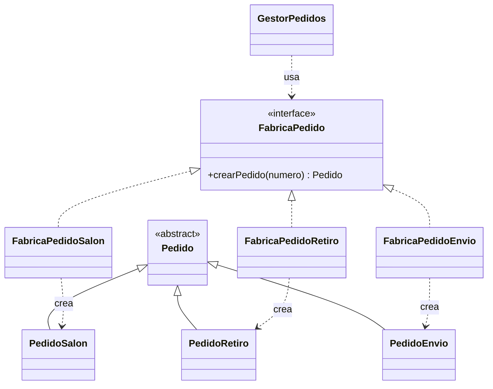
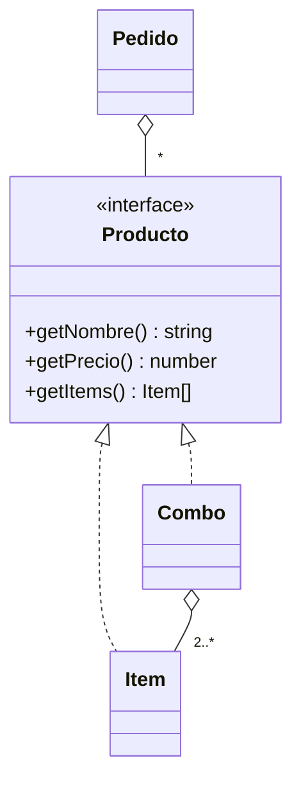
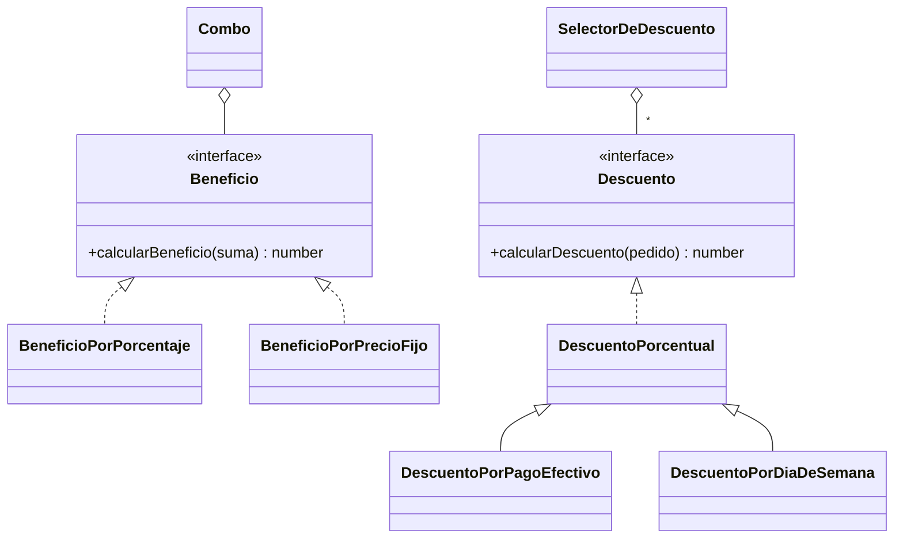
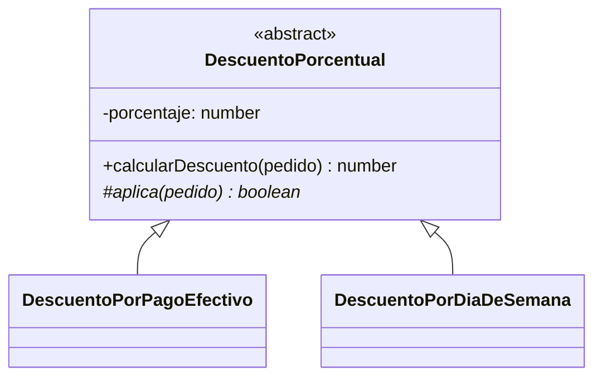
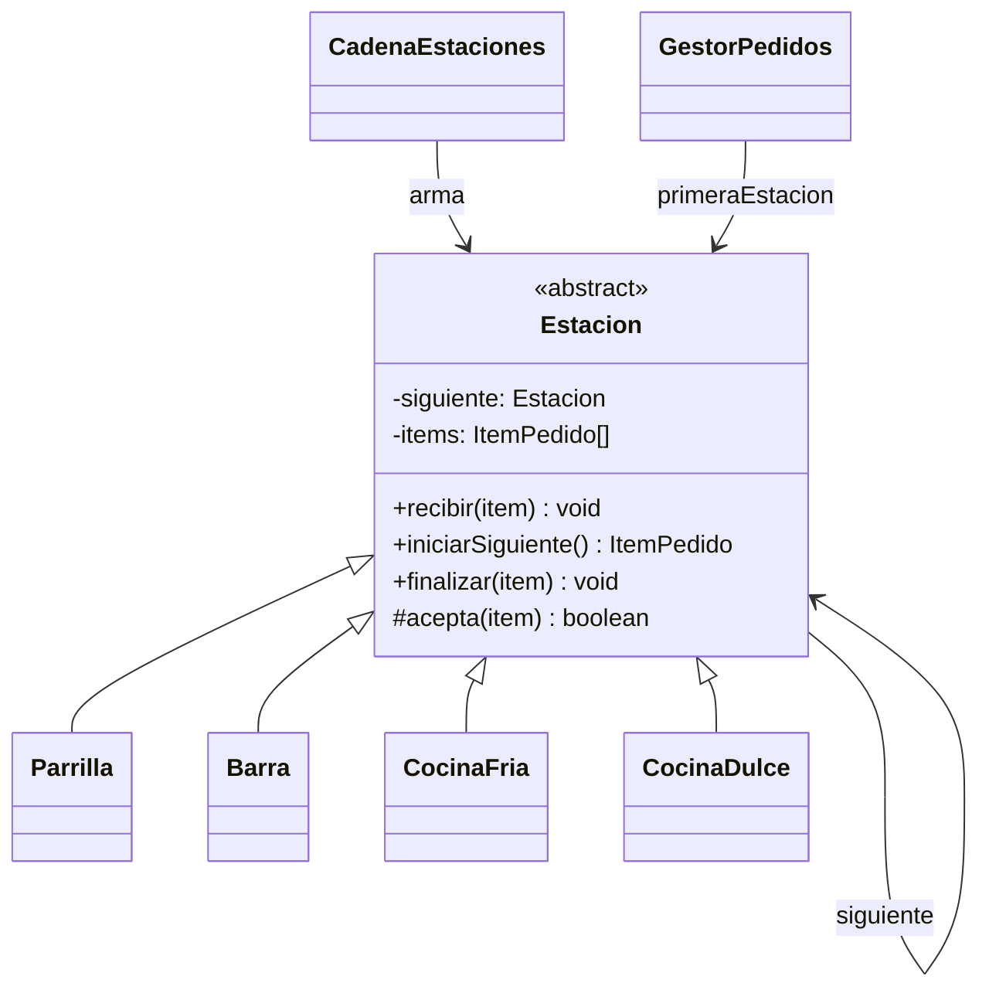
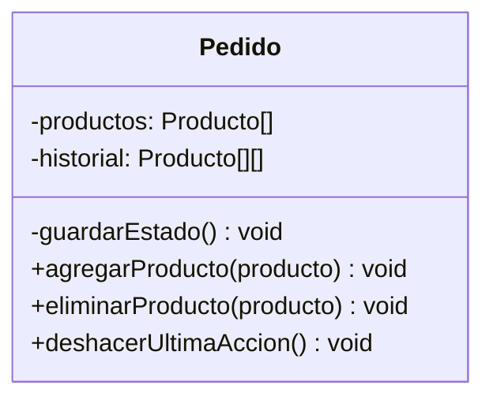

# 🍽️ Fogón del Barrio — Gestión de Pedidos

Trabajo práctico de **Programación II** (Grupo 5).

Sistema en TypeScript que digitaliza la gestión de pedidos del restaurante "Fogón del Barrio". Cubre todo el recorrido de un pedido:

1. El cliente lo realiza.
2. La cocina lo prepara, repartido entre sus estaciones.
3. Se genera la cuenta con el mejor descuento disponible.
4. Queda guardado en el historial.

## Integrantes

| Nombre | Usuario de GitHub |
|---|---|
| Bruno Enrigo | juanfdamelio |
| Juan Francisco Damelio | BrunoE99 |

---

## Tabla de contenidos

- [Requisitos](#requisitos)
- [Instalación](#instalación)
- [Compilación y ejecución](#compilación-y-ejecución)
- [Pruebas y cobertura](#pruebas-y-cobertura)
- [Estilo de código (ESLint)](#estilo-de-código-eslint)
- [Documentación del código (JSDoc)](#documentación-del-código-jsdoc)
- [Estructura del proyecto](#estructura-del-proyecto)
- [Funcionamiento](#funcionamiento)
- [Requerimientos funcionales](#requerimientos-funcionales)
- [Patrones de diseño](#patrones-de-diseño)
- [Manejo de errores](#manejo-de-errores)
- [Diagramas](#diagramas)

---

## Requisitos

- [Node.js](https://nodejs.org/) en una versión LTS (incluye `npm`).
- Opcional: Visual Studio Code con las extensiones ESLint, Jest y PlantUML.

## Instalación

Desde la carpeta del proyecto:

```bash
npm install
```

## Compilación y ejecución

| Comando | Qué hace |
|---|---|
| `npm run dev-mode` | Ejecuta `src/index.ts` directamente con `ts-node`, sin compilar. Es la forma más rápida de ver la demo. |
| `npm run build` | Limpia `dist/`, corre ESLint y compila con `tsc`. **Falla si hay errores de lint.** |
| `npm start` | Ejecuta la versión compilada (`dist/index.js`). Requiere `npm run build` antes. |
| `npm run start:dev` | `build` + `start` en un solo paso. |

### Qué muestra la demo

`src/index.ts` arma el menú y registra 3 pedidos, uno por modalidad:

| Pedido | Modalidad | Productos | Medio de pago |
|---|---|---|---|
| 1 | Salón | Combo Hamburguesa y Flan | Efectivo |
| 2 | Retiro | Combo Parrillero | Billetera virtual |
| 3 | Envío | Ensalada César y Gaseosa | Efectivo |

Después de registrarlos, la demo:

1. Confirma los pedidos.
2. Hace que cada estación prepare sus ítems en orden de llegada.
3. Factura los pedidos.
4. Imprime el historial con el detalle de cada factura.

Esta es la salida esperada un día en que no rige el descuento por día de la semana:

```text
[Parrilla] Pedido 1: Hamburguesa
[Parrilla] Pedido 2: Bife de chorizo
[Barra] Pedido 1: Gaseosa
[Barra] Pedido 2: Gaseosa
[Barra] Pedido 3: Gaseosa
[Cocina fria] Pedido 1: Ensalada cesar
[Cocina fria] Pedido 3: Ensalada cesar
[Cocina dulce] Pedido 1: Flan
[Cocina dulce] Pedido 2: Flan
Historial de pedidos:
Factura del pedido 1:
--------------------------------------------------
Combo Hamburguesa: $7650.00
Flan: $1800.00
--------------------------------------------------
Subtotal: $9450.00
Descuento: $945.00
Total: $8505.00
...
```

Si algo falla, el `index` atrapa los errores propios del sistema (`ErrorRestaurante`) y muestra su mensaje.

## Pruebas y cobertura

Las pruebas unitarias usan [Jest](https://jestjs.io/) con `ts-jest` y están en la carpeta `tests/`.

```bash
# compila (lint + tsc) y ejecuta todas las pruebas
npm test

# ejecuta solo las pruebas, sin compilar
npx jest

# ejecuta las pruebas y genera el reporte de cobertura (carpeta coverage/)
npx jest --coverage
```

El objetivo es una cobertura **superior al 80 %**. El reporte HTML queda en `coverage/lcov-report/index.html`.

## Estilo de código (ESLint)

El proyecto usa la configuración de ESLint provista por la cátedra (`eslint.config.js`). Algunas de sus reglas:

- `PascalCase` en clases.
- `camelCase` en métodos y variables.
- `UPPER_CASE` en constantes globales.
- Nombres de al menos 4 caracteres.
- Sin números mágicos.
- Métodos de 40 líneas como máximo.

```bash
npm run lint       # reporta errores
npm run lint-fix   # corrige automáticamente lo que se pueda
```

## Documentación del código (JSDoc)

Todas las clases y métodos públicos están documentados con comentarios JSDoc. Cada comentario indica:

- **Parámetros** (`@param`).
- **Valor de retorno** (`@returns`).
- **Excepciones** que puede lanzar (`@throws`), incluidas las que se propagan desde otras clases.
- **Ejemplos de uso** (`@example`).

Para generar el sitio HTML de la documentación:

```bash
npx typedoc
```

El resultado queda en `docs/`.

## Estructura del proyecto

```text
├── diagramas/              Diagramas UML (PlantUML)
├── src/
│   ├── index.ts            Demo: punto de entrada
│   ├── beneficio/          Beneficios de combos y descuentos sobre el pedido
│   ├── calculo_dia/        Obtiene el día de la semana de una fecha
│   ├── empleados-cliente/  Cliente
│   ├── enums/              Categoria, DiaSemana, EstadoItem, EstadoPedido
│   ├── estacion/           Estaciones de cocina y la cadena que las une
│   ├── excepciones/        Jerarquía de errores propios (pedido/, estacion/, menu/)
│   ├── medios_de_pago/     Efectivo, tarjetas (débito/crédito), billetera virtual
│   ├── menu/               Menú, productos individuales (Item) y combos
│   └── pedido/             Pedido y sus modalidades, gestor, factura, numerador
│       └── fabrica/        Fábricas de cada modalidad de pedido
├── tests/                  Pruebas unitarias (Jest)
├── eslint.config.js        Reglas de estilo (provistas por la cátedra)
├── jest.config.js
├── tsconfig.json
└── package.json
```

## Funcionamiento

`GestorPedidos` es el punto de entrada del sistema: registra los pedidos y los identifica por número, los confirma y los factura.

### Ciclo de vida de un pedido

```text
                 agregar / quitar / deshacer
                        ┌──────┐
                        ▼      │
  registrarPedido ─► EN_CONSTRUCCION ──confirmarPedido──► CONFIRMADO ──facturarPedido──► FACTURADO
                                                              │                       (historial
                                              los ítems van a las estaciones           + factura)
```

### Ciclo de vida de un ítem en la cocina

```text
  PENDIENTE ──iniciarSiguiente──► EN_PREPARACION ──finalizar──► LISTO
```

Al confirmarse, el pedido desarma cada producto (los combos también) en sus ítems. Cada ítem recorre la cadena de estaciones hasta encontrar la que prepara su categoría:

| Estación | Categoría |
|---|---|
| Parrilla | `CARNE` |
| Barra | `BEBIDA` |
| Cocina fría | `ENSALADA` |
| Cocina dulce | `POSTRE` |

Cada estación atiende sus ítems **en el orden en que llegaron** (cola FIFO).

### Precio y descuentos

- **Precio del pedido**: es la suma de sus productos. El precio de un combo es la suma de sus ítems con su beneficio aplicado, que puede ser un porcentaje o un precio fijo.
- **Total a cobrar**: es el precio menos **un solo** descuento, el más conveniente para el cliente. Los descuentos disponibles son:
  - **Pago en efectivo**: 10 % por defecto.
  - **Día de la semana**: lunes y 15 % por defecto. Tanto el día como el porcentaje se pueden configurar.

---

## Requerimientos funcionales

| # | Requerimiento | Dónde se implementa |
|---|---|---|
| 1 | Registrar un pedido en una de las tres modalidades | `GestorPedidos.registrarPedido` y las fábricas de `pedido/fabrica/` |
| 2 | Agregar y quitar productos mientras está en construcción | `Pedido.agregarProducto` / `eliminarProducto` |
| 3 | Deshacer la última modificación | `Pedido.deshacerUltimaAccion` |
| 4 | Confirmar y distribuir los ítems entre las estaciones | `GestorPedidos.confirmarPedido` y `Estacion.recibir` |
| 5 | Cada estación procesa en orden de llegada y marca el avance | `Estacion.iniciarSiguiente` / `finalizar` e `ItemPedido` |
| 6 | Impedir modificar un ítem en preparación | `Pedido` deja de admitir cambios al confirmarse, e `ItemPedido` valida cada cambio de estado |
| 7 | No facturar hasta que todos los ítems estén listos | `Pedido.facturarPedido` y `todosItemsListos` |
| 8 | Calcular el precio total con combos y beneficios | `Pedido.getPrecioTotal`, `Combo.getPrecio` y `Beneficio` |
| 9 | Aplicar solo el descuento más beneficioso | `SelectorDeDescuento.obtenerMejorDescuento` |
| 10 | Consultar el historial con lo cobrado | `GestorPedidos.getHistorial` / `consultarFactura` y `Factura` |

---

## Patrones de diseño

| Patrón | Categoría | Dónde |
|---|---|---|
| [Factory Method](#1-factory-method) | Creacional | Creación de pedidos según su modalidad |
| [Composite](#2-composite) | Estructural | Productos individuales y combos |
| [Strategy](#3-strategy) | Comportamiento | Beneficio de cada combo y descuentos del pedido |
| [Template Method](#4-template-method) | Comportamiento | Cálculo de los descuentos porcentuales |
| [Chain of Responsibility](#5-chain-of-responsibility) | Comportamiento | Distribución de ítems entre las estaciones |
| [Memento](#6-memento) | Comportamiento | Deshacer cambios en un pedido en construcción |

### 1. Factory Method

**Categoría:** creacional.

**Problema.** El enunciado pide que *"en un futuro sea sencillo sumar nuevas modalidades sin tener que rehacer todo el sistema"*. Cada modalidad necesita datos distintos:

- Salón: la mesa.
- Retiro: el horario y el teléfono.
- Envío: la dirección.

Sin el patrón, `GestorPedidos` tendría un `if`/`switch` por modalidad, y habría que modificarlo cada vez que se agrega una.

**Participantes.**

| Rol | Clase |
|---|---|
| Creador (interfaz) | `FabricaPedido` |
| Creadores concretos | `FabricaPedidoSalon`, `FabricaPedidoRetiro`, `FabricaPedidoEnvio` |
| Producto | `Pedido` (abstracta) |
| Productos concretos | `PedidoSalon`, `PedidoRetiro`, `PedidoEnvio` |
| Cliente | `GestorPedidos.registrarPedido(fabrica)` |

**Diagrama.**



**Justificación.**

- **Ventajas:**
  - El gestor asigna el número y guarda el pedido sin conocer su modalidad.
  - Una modalidad nueva se suma con un `Pedido` y una `Fabrica` nuevos, sin tocar el gestor (principio abierto/cerrado).
  - Cada fábrica recibe en su constructor los datos propios de su modalidad.
- **Costos:** cada modalidad requiere dos clases, y se agrega un nivel de indirección.

### 2. Composite

**Categoría:** estructural.

**Problema.** Un pedido contiene productos individuales y combos, y ambos deben poder agregarse, quitarse y cotizarse de la misma forma. Al confirmar, los dos tienen que desarmarse en los ítems que prepara la cocina.

**Participantes.**

| Rol | Clase |
|---|---|
| Componente | `Producto` (interfaz: `getNombre`, `getPrecio`, `getItems`) |
| Hoja | `Item` (`getItems` devuelve `[this]`) |
| Compuesto | `Combo` (`getItems` devuelve sus ítems y `getPrecio` aplica su beneficio) |
| Cliente | `Pedido` (trabaja solo con `Producto`) |

**Diagrama.**



**Justificación.**

- **Ventajas:** `Pedido` calcula precios y genera los ítems de cocina sin preguntar si cada producto es un combo, así que no hay condicionales por tipo.
- **Limitación:** un `Combo` agrupa `Item`s y no otros `Producto`s, por lo que no admite combos dentro de combos. Es una simplificación deliberada, porque el enunciado no lo pide.

### 3. Strategy

**Categoría:** comportamiento. Se aplica en dos lugares.

#### 3a. Beneficio del combo

**Problema.** El enunciado dice que *"el beneficio del combo puede expresarse de distintas formas (…) un descuento porcentual (…) o un precio fijo cerrado"*. También pide poder crear combos nuevos sin modificar el sistema.

**Participantes.**

| Rol | Clase |
|---|---|
| Estrategia | `Beneficio` (interfaz: `calcularBeneficio(suma)`, que devuelve el precio final) |
| Estrategias concretas | `BeneficioPorPorcentaje`, `BeneficioPorPrecioFijo` |
| Contexto | `Combo` |

#### 3b. Descuentos sobre el pedido

**Problema.** Hay varios descuentos posibles (efectivo, día de la semana), cada uno con su propia condición. Hay que aplicar solo el más conveniente.

**Participantes.**

| Rol | Clase |
|---|---|
| Estrategia | `Descuento` (interfaz: `calcularDescuento(pedido)`, que devuelve el monto a restar) |
| Estrategias concretas | `DescuentoPorPagoEfectivo`, `DescuentoPorDiaDeSemana` |
| Contexto | `SelectorDeDescuento` (evalúa todas las estrategias y se queda con el mayor monto) |

**Diagrama.**



**Justificación.**

- **Ventajas:**
  - Cada forma de calcular queda en su propia clase, sin condicionales.
  - Un combo o un descuento nuevo es solo una clase nueva que implementa la interfaz.
  - El selector elige el mejor descuento comparando montos, sin saber de qué tipo es cada uno.
  - Las estrategias se prueban por separado.
- **Costos:** hay más clases pequeñas. Además, `Beneficio` devuelve el *precio final* y `Descuento` el *monto a restar*: son dos contratos distintos que hay que tener presentes.

### 4. Template Method

**Categoría:** comportamiento.

**Problema.** Los dos descuentos calculan el monto del mismo modo (un porcentaje del total) y solo cambian en **cuándo** aplican: si se paga en efectivo, o si es el día indicado.

**Participantes.**

| Rol | Clase |
|---|---|
| Clase abstracta | `DescuentoPorcentual`: `calcularDescuento` es el método plantilla y `aplica` es el paso abstracto |
| Clases concretas | `DescuentoPorPagoEfectivo` y `DescuentoPorDiaDeSemana`, que implementan `aplica` |

**Diagrama.**



**Justificación.**

- **Ventaja:** el cálculo del porcentaje está en un único lugar, y cada subclase solo expresa su condición.
- **Limitación:** sirve para descuentos *porcentuales*. Un descuento de monto fijo implementaría `Descuento` directamente.

### 5. Chain of Responsibility

**Categoría:** comportamiento.

**Problema.** El enunciado pide que *"si en el futuro agrega una estación nueva, esto no implique reescribir la lógica ya existente de las demás estaciones"*. Cada ítem tiene que llegar a la estación que lo prepara.

**Participantes.**

| Rol | Clase |
|---|---|
| Manejador | `Estacion` (abstracta: `recibir`, `acepta`, `setSiguiente`) |
| Manejadores concretos | `Parrilla`, `Barra`, `CocinaFria`, `CocinaDulce` |
| Armado de la cadena | `CadenaEstaciones` |
| Emisor | `GestorPedidos`, que solo conoce la primera estación |

**Diagrama.**



**Justificación.**

- **Ventajas:**
  - El gestor no sabe cuántas estaciones existen ni qué prepara cada una.
  - Una estación nueva se suma con una subclase y una línea en `CadenaEstaciones`, sin modificar las demás.
  - Cada estación mantiene su propia cola FIFO.
- **Costos:**
  - Un ítem recorre la cadena hasta encontrar su estación.
  - Si ninguna lo acepta, se lanza `ErrorEstacionNoEncontrada`.

### 6. Memento

**Categoría:** comportamiento.

**Problema.** El enunciado plantea que *"el mozo necesita poder 'borrar' lo escrito hasta alcanzar el ítem a corregir"* sin descartar el pedido. Hay que poder volver atrás varios pasos, y solo mientras el pedido está en construcción.

**Participantes.**

| Rol | Clase |
|---|---|
| Originador | `Pedido` (guarda y restaura su lista de productos) |
| Memento | Una copia de la lista de productos (`Producto[]`) |
| Cuidador | La pila `Pedido.historial` |

**Diagrama.**



**Justificación.**

- **Ventajas:**
  - Antes de cada cambio se guarda una copia del estado, y deshacer la recupera de la pila (LIFO).
  - Se puede retroceder varios pasos.
  - No hace falta saber qué operación se hizo, porque siempre se restaura el estado anterior completo.
- **Limitaciones:**
  - Es una versión simplificada del patrón: el cuidador vive dentro del propio `Pedido` y el memento es una copia del arreglo, no una clase propia.
  - Guarda una copia por cada cambio, aunque para el tamaño de un pedido es despreciable.

---

## Manejo de errores

Los errores del dominio forman una jerarquía propia:

```text
Error
└── ErrorRestaurante (abstracta)
    ├── pedido/   ErrorPedidoNoExiste, ErrorPedidoEstadoIncorrecto, ErrorPedidoYaFacturado,
    │             ErrorPedidoSinProductos, ErrorPedidoItemsNoListos, ErrorPedidoNoExisteMedioDePago,
    │             ErrorItemPedidoEstadoIncorrecto, ErrorPedidoSinAccionesParaDeshacer
    ├── estacion/ ErrorEstacionNoEncontrada, ErrorEstacionSinItems, ErrorEstacionItemNoEnPreparacion
    └── menu/     ErrorComboMinimoItems
```

Cada excepción arma su mensaje con los datos del caso, como el número de pedido, el ítem o la estación. Quien usa el sistema puede atrapar todos los errores propios con un único `catch (error) { if (error instanceof ErrorRestaurante) … }` y relanzar cualquier otro error.

## Diagramas

Los diagramas están en la carpeta `diagramas/`, en formato PlantUML:

- [`clasesTP.puml`](diagramas/clasesTP.puml): diagrama de clases de la solución.
- Diagramas de secuencia: _pendiente_.

Para verlos en VS Code, instalar la extensión **PlantUML** y abrir el archivo con `Alt + D`.
